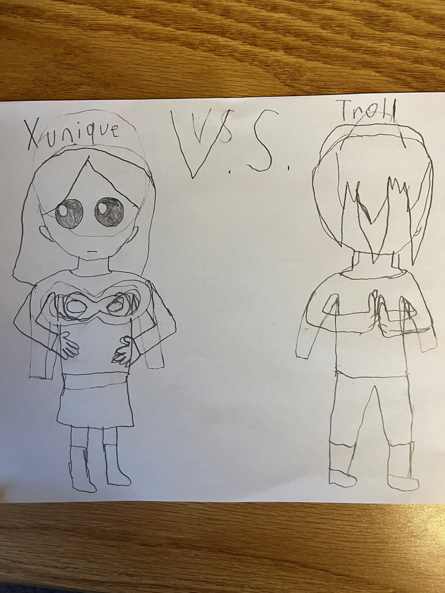

# Comics and rhetoric visual project pitch
## Question/problem/idea

The idea I want to explore is how visuals are used in resources for learning programming. My purpose in exploring this idea
is what kinds of resources use visuals, how visuals are helpful, and analyzing the visuals and linguistic text in similar ways
to those used in this class.

## Background/significance

My topic is important because it includes sources used for college classes in real life. For example, I was assigned The
original "Learn You a Haskell for Great Good" by Miran Lipovača in CS119.

## Research Plan

I am using https://arxiv.org/ to find academic sources. One non-academic primary source I want to use
is https://learnyouahaskell.github.io/chapters.html. A non-academic secondary source I want to use is 
https://alexott.net/en/fp/books/ because it reviews "Learn You a Haskell for Great Good" and similar
books from the perspective of an experienced software developer.

## Works Cited

Barski, Conrad. "Casting SPELs in Lisp" https://www.lisperati.com/casting.html  
Lipovača, Miran. "Learn You a Haskell for Great Good" http://learnyouahaskell.com/  
Modrak, Stanislav. "learnyouahaskell.github.io" https://github.com/learnyouahaskell/learnyouahaskell.github.io  
Ott, Alex. "Functional Programming Books overview" https://alexott.net/en/fp/books/  